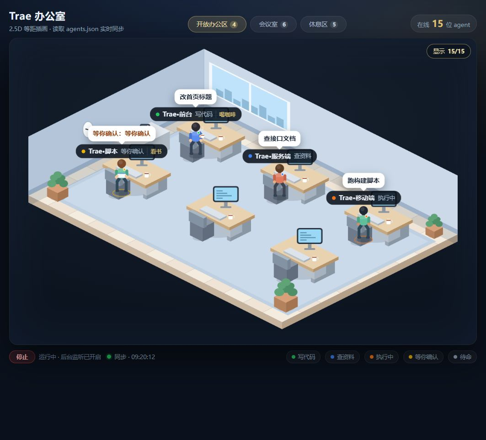
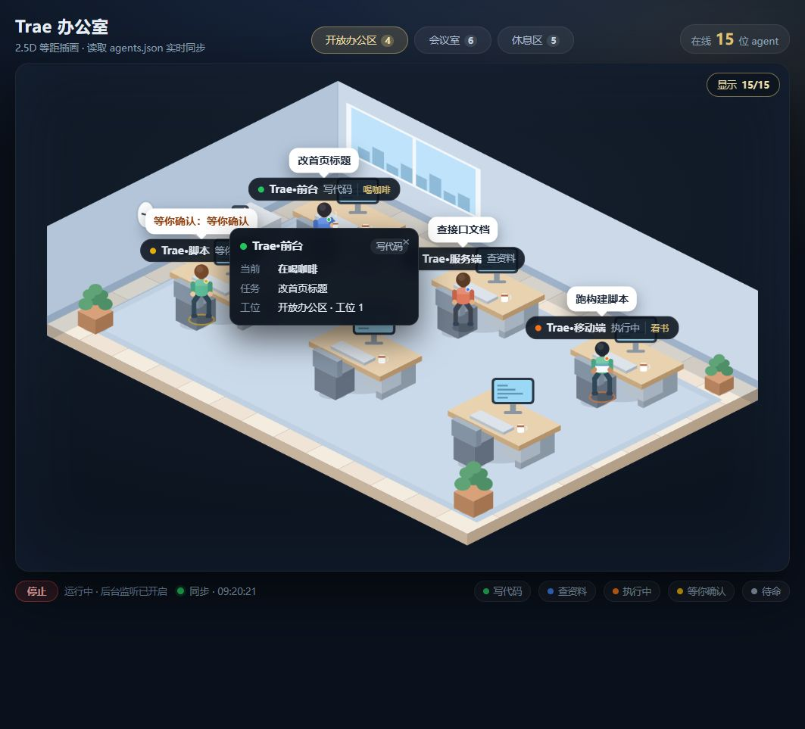
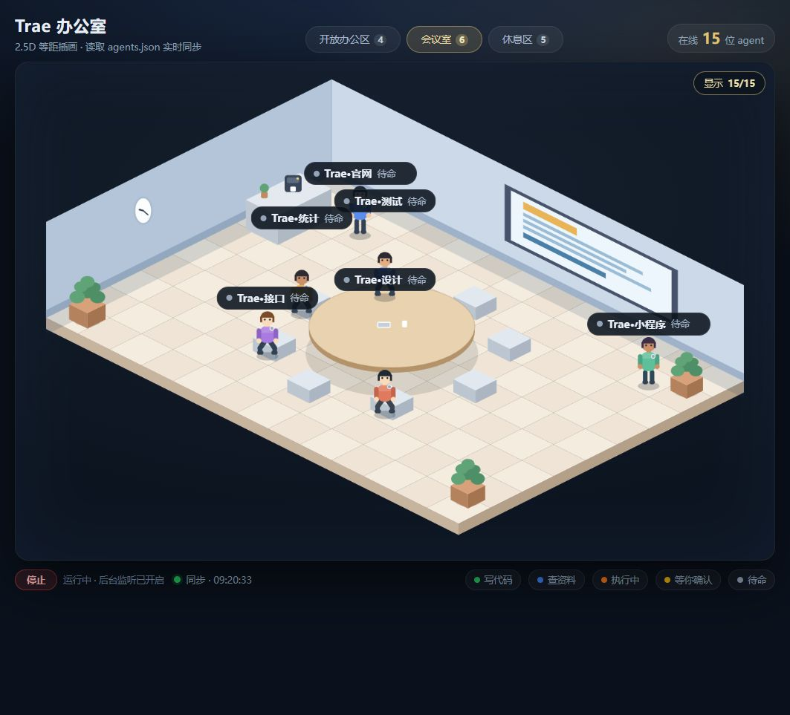
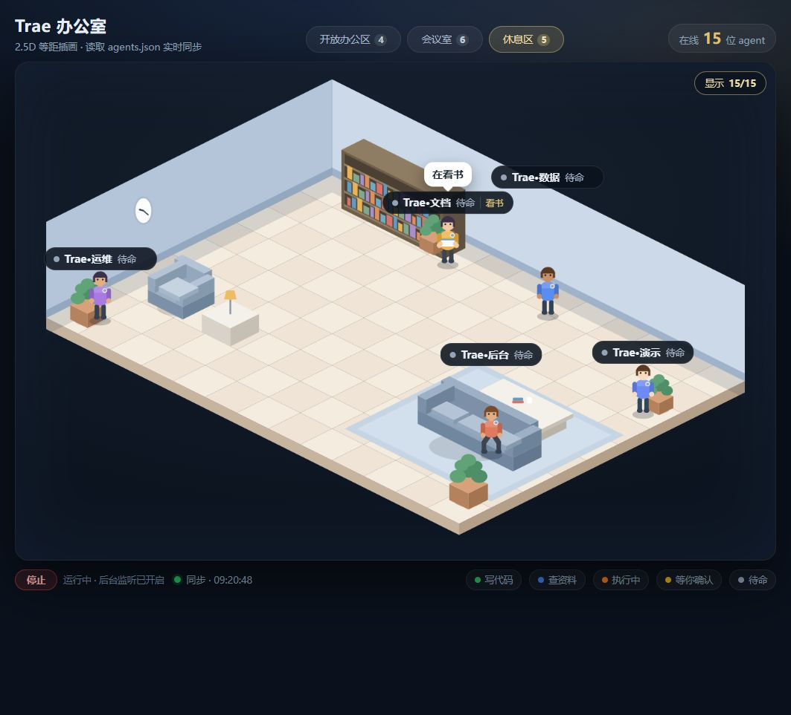

# Trae 办公室 · 2.5D Pixel Office

**把「AI 正在改哪个项目、在改什么、是不是在等你确认」画成一间会动的像素办公室。**

A zero-dependency, single-file Node server that renders a hand-drawn 2.5D isometric office on Canvas — each AI agent is a little person working at a desk. Feed it an `agents.json`, and the page updates in real time.



---

## 这是什么

用 Trae / Cursor / Claude Code 这类工具同时推进好几个项目时，你通常只能看到「当前这一个会话」。

这个项目把本机所有 agent 的状态汇总成一张画：

- **谁在办公区干活** → 那个项目现在就有人在改
- **谁在会议室 / 休息区** → 那个项目目前待命
- **谁头顶气泡里有字** → 他正在改什么
- **谁脚下有金圈** → 它正在执行命令 / 等你确认

它不读你的代码，也不接管任何进程，只是一个「状态展示层」：任何能写 JSON 的 agent 都能接进来。

## 截图

| 开放办公区 | 点人物看详情 |
|---|---|
|  |  |

| 会议室（待命的人在这） | 休息区（另一半待命的人） |
|---|---|
|  |  |

## 功能

- **三个房间按状态自动分流**：`writing / researching / executing / waiting` 去开放办公区；`idle` 的人均分到会议室与休息区，位置在会话内固定，不会来回跳。
- **五种状态**：写代码（绿）· 查资料（蓝）· 执行中（橙，脚下金色光环）· 等你确认（黄）· 待命（灰）。
- **小人会自己动**：坐下时随机「喝咖啡 / 看书 / 看报纸 / 伸懒腰」；待命的人每 9~21 秒有 60% 概率起身去咖啡角、窗前、书架旁散步再回来。
- **头顶气泡**显示它正在改什么（超长自动截断），名字胶囊显示「名字 + 状态 + 当前动作」。
- **点人物看详情**：当前动作 / 完整任务 / 在哪个房间哪个工位。
- **显示开关**：「显示 12/12」里可以单独隐藏某些人，选择记在 `localStorage`。
- **停止 / 继续**：页面左下角能直接停掉后台的目录监听子进程（唯一吃 CPU 的部分），静态页面服务保留。
- **竖屏自动堆叠**：宽屏用标签切换；竖屏或窄窗口自动把三间房上下排开。
- **实时性**：`agents.json` 一变，200ms 内通过 **SSE** 推送到浏览器；不支持 SSE 时自动降级为 1.2 秒轮询。
- **可选墙面品牌**：默认白墙，想挂自己的 LOGO / 公司名就填 `branding.json`（见下文），不需要改代码。

## 快速开始

```bash
git clone <本仓库地址>
cd pixel-office-mini
node server.js
# 打开 http://127.0.0.1:8899
```

- Node **18+**，**零依赖**，不用 `npm install`。
- Windows 可以直接双击 `启动办公室.bat`。
- 首次运行没有 `agents.json` 时，会自动从 `agents.example.json` 复制一份，页面立刻有内容。
- 想看小人在动：另开一个终端 `node demo.js`（每 4 秒随机制造一次状态变化）。

## 数据格式：`agents.json`

```json
{
  "updated": 1763500000000,
  "agents": [
    { "id": "web", "name": "Trae·官网", "state": "writing", "task": "改首页标题", "seat": "desk-1" }
  ]
}
```

| 字段 | 说明 |
|---|---|
| `id` | 唯一标识，用来追踪同一个小人（缺省按数组下标生成） |
| `name` | 头顶名字 |
| `state` | `writing` / `researching` / `executing` / `waiting` / `idle` |
| `task` | 气泡文案（超过 12 字截断） |
| `seat` | `desk-1` ~ `desk-6`；同名会向右错开，不写则按顺序分配 |

写入时请**原子替换**（先写临时文件再 rename），避免页面读到半个 JSON：

```js
const fs = require('fs');
function reportAgents(agents) {
  const tmp = 'agents.json.tmp';
  fs.writeFileSync(tmp, JSON.stringify({ updated: Date.now(), agents }, null, 2));
  fs.renameSync(tmp, 'agents.json');
}
```

## 用 Trae 的用户怎么接进来

Trae 目前**没有公开的 agent 事件接口**，所以这里用「关键节点打点 + 目录监听」做近似。效果是实时的，粒度是「文件 / 动作」级，不是每一次工具调用。

### 方式 1：手动打点（最准，推荐）

```bash
node adapters/trae.js --id trae1 --name "Trae" --seat desk-1 --state writing --task "改首页标题"
node adapters/trae.js --id trae1 --name "Trae" --seat desk-1 --state waiting --task "等你确认"
node adapters/trae.js --id trae1 --name "Trae" --seat desk-1 --state idle    --task "待命"
```

在项目 `.trae/rules/` 里写一条规则，让 Trae 在这四个时机各执行一次即可：

1. 开始改文件 / 写代码前 → `--state writing --task "改 <模块>"`
2. 执行命令前（构建、部署、批量脚本）→ `--state executing --task "跑 <命令>"`
3. 需要你确认 / 等待回答 → `--state waiting --task "<要确认的事>"`
4. 本批任务收尾 → `--state idle --task "待命"`

规则示例：

```md
## 打点（让 Trae 的工作状态出现在页面上）
- 改文件前：node <路径>\adapters\trae.js --id trae1 --name "Trae" --seat desk-1 --state writing --task "改 <文件名>"
- 跑命令前：同上，--state executing
- 等你确认：同上，--state waiting
- 任务结束：同上，--state idle
```

> 规则属于「约定式」，不保证每次都执行；不想所有会话都打点时不要加。

### 方式 2：目录监听（不用改 agent）

```bash
node adapters/trae.js --watch "D:\code\my-project" --id trae1 --name "Trae" --seat desk-1
```

监听整个项目目录：有文件变化就显示「正在改 xxx」，25 秒没有新变化自动回到待命。可以开多个实例、绑不同 `seat`，形成多工位效果。

### 方式 3：多项目统一监听（推荐多项目用）

复制示例清单，改成你自己的项目路径：

```bash
copy projects.example.json projects.json     # macOS/Linux: cp
node start-agents.js
```

```json
[
  { "id": "web",   "name": "Trae·官网",   "seat": "desk-1", "watch": "D:\\code\\project-a" },
  { "id": "admin", "name": "Trae·后台",   "seat": "desk-2", "watch": "D:\\code\\project-b" }
]
```

- 单进程同时监听所有目录；哪个项目有文件变动，对应小人就跑到办公区坐下。
- 目录不存在会打印 `[跳过]`，不影响其他项目。
- 手动打点写了 `waiting` 时，目录监听**不会**把它覆盖掉（避免「等你确认」被下一次保存冲掉）。
- 手动打点与目录监听可以用同一个 `id`（比如都叫 `trae1`），会合并成同一个人。

## 配置

| 文件 | 作用 | 是否入库 |
|---|---|---|
| `agents.json` | 运行状态，被监听器不停改写 | 忽略（自动从示例生成） |
| `projects.json` | 你要监听的本地项目路径 | **忽略**，复制 `projects.example.json` 后自行填写 |
| `public/branding.json` | 墙面 LOGO / 公司名 | **忽略**，复制 `public/branding.example.json` 后填写 |

`public/branding.json`：

```json
{ "logo": "./assets/logo.png", "wallText": "你的公司名称" }
```

`logo` 是相对页面根目录的路径（放到 `public/assets/` 下），`wallText` 会刷在办公区后墙上。**留空或不建这个文件，墙面就是干净的**。

环境变量：

| 变量 | 默认 | 说明 |
|---|---|---|
| `PORT` | `8899` | 端口 |
| `OFFICE_AUTOSTART` | 开启 | 设为 `0` 时启动服务不自动拉起目录监听（只想看页面时用） |

## 页面操作

| 操作 | 效果 |
|---|---|
| 点顶部标签 | 切换开放办公区 / 会议室 / 休息区（标签上带实时人数） |
| 点小人或名字胶囊 | 弹出详情卡；点空白处或 `Esc` 关闭 |
| 右上「显示 12/12」 | 逐个开关要显示的人，支持全显示 / 全隐藏 |
| 左下「停止 / 继续」 | 停止或重新拉起后台目录监听（灰罩 = 已停止） |
| `?room=1` / `?room=2` | 直接打开会议室 / 休息区 |
| `?poll=1` | 强制走轮询（截图、无头浏览器场景用，避免 SSE 长连接） |

## 接口

| 接口 | 说明 |
|---|---|
| `GET /api/agents` | 返回 `agents.json` 原文（`Cache-Control: no-store`） |
| `GET /api/stream` | SSE，文件变化 200ms 内推送 |
| `GET /api/status` | `{ running, pid, since }` 后台监听状态 |
| `POST /api/control` | body `{"action":"stop"}` / `{"action":"start"}` |

## 目录结构

```
pixel-office-mini/
├── server.js               # 静态服务 + /api/* + SSE + 监听子进程托管
├── start-agents.js         # 多项目目录监听（单进程）
├── adapters/trae.js        # 单项目打点 / 监听 CLI
├── demo.js                 # 演示：每 4 秒随机制造状态变化
├── agents.example.json     # 示例状态
├── projects.example.json   # 示例项目清单
├── public/
│   ├── index.html
│   ├── app.js              # Canvas 渲染、动画、交互（单文件）
│   ├── branding.example.json
│   └── assets/             # 可选 LOGO 放这里
└── docs/screenshots/
```

## 隐私与安全

- 服务**只监听 `127.0.0.1`**，默认不对外网开放。
- `agents.json` 里会有你的**项目名与正在改的文件名**，属于内部信息：**不要直接把页面暴露到公网**。远程看建议走 SSH 隧道或加一层带鉴权的反向代理。
- 仓库里没有任何密钥；`projects.json`、`branding.json`、LOGO 都已加入 `.gitignore`。

## 已知限制

- Trae 没有公开事件接口，状态是「打点 + 文件活动」的近似，不是精确到每一次工具调用。
- 走路是直线插值，没有寻路（不会绕开桌子）。
- 人物是程序化绘制的，换装 / 换地图需要改 `public/app.js`。

## Roadmap

- 换 PixiJS + Tiled 地图 + sprite sheet，做成真正的小游戏观感
- 网格 A* 寻路，走路不穿墙
- 座位保留池，避免多个 agent 抢同一把椅子
- 更多房间（机房、打印区）与夜间模式

## 许可

[MIT](LICENSE)
